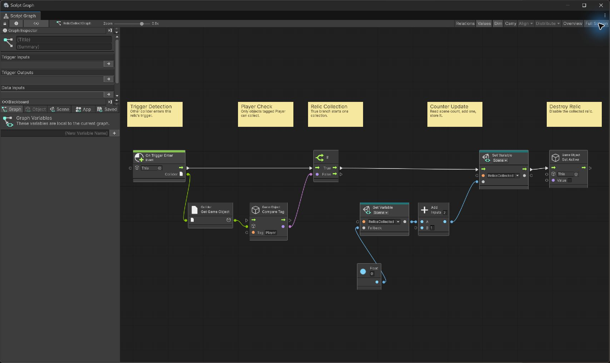
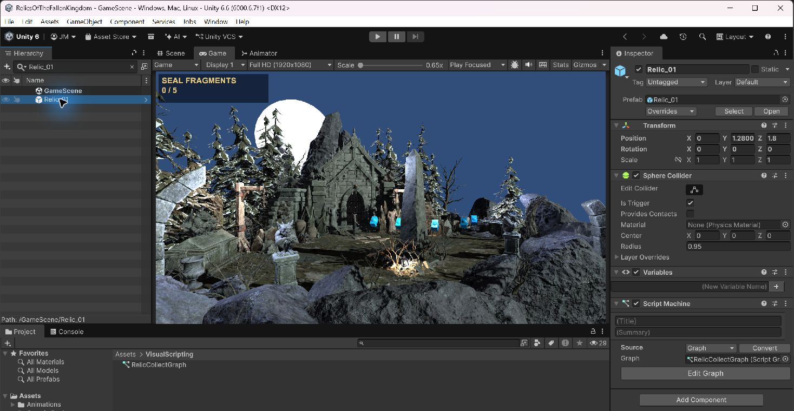
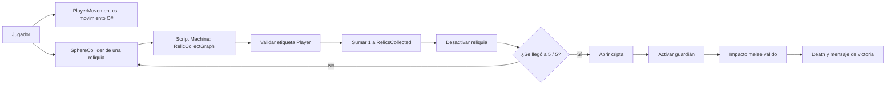
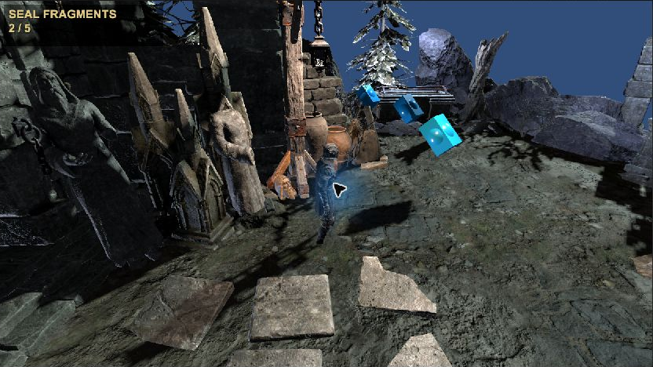
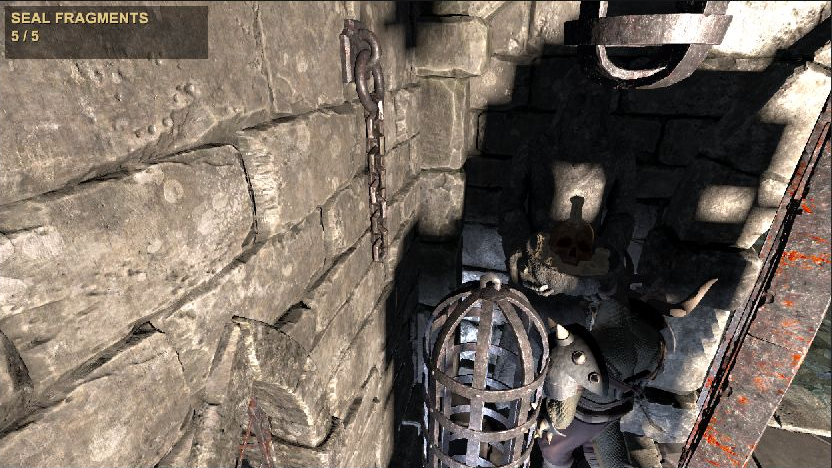

# Relics of the Fallen Kingdom

**Autor:** Julio<br>
**Motor y versión:** Unity 6.6, 6000.6.7f1<br>
**Renderizado:** Universal Render Pipeline (URP 17.6)

Prototipo 3D desarrollado en Unity para comparar la programación tradicional con C# y Unity Visual Scripting. El movimiento del jugador y los sistemas de juego se implementan con C#; la interacción para recoger objetos se realiza mediante Visual Scripting. El caballero explora una necrópolis, recupera cinco fragmentos de un sello real y abre la cripta para enfrentarse al guardián final.

## Video explicativo

El video presenta el movimiento implementado con scripts C#, la recolección de reliquias con Unity Visual Scripting, la interacción mediante colliders, el resultado de juego y los principales desafíos y soluciones del desarrollo. También compara C# con Visual Scripting.

[Ver video explicativo en YouTube](https://youtu.be/j9gA9pXvLDU)

## Objetivo de la actividad

El objetivo académico es comparar C# tradicional y Visual Scripting mediante una implementación práctica. Para ello, el proyecto:

- Implementa el movimiento del jugador con scripts C#.
- Implementa la recolección de objetos mediante un evento de collider en Unity Visual Scripting.
- Analiza facilidad de implementación, legibilidad y escalabilidad en ambos enfoques.

## Descripción del prototipo

El jugador controla a un caballero que explora una necrópolis antigua. A lo largo del escenario hay cinco fragmentos mágicos pertenecientes a un sello real caído. El contador muestra el progreso hasta **5 / 5 Seal Fragments**.

Al recuperar los cinco fragmentos, el sello se restaura, se abre la cripta y se activa el guardián Lizardman. Derrotarlo completa el prototipo. El encuentro final amplía el ejercicio académico; los requisitos principales siguen siendo el movimiento en C# y la recolección con Visual Scripting.

## Controles

| Control | Acción |
|---|---|
| W, A, S, D | Movimiento relativo a la orientación horizontal de la cámara |
| Shift + W, A, S, D | Correr |
| Clic izquierdo | Atacar |
| Mantener clic derecho y mover el mouse | Orbitar la cámara alrededor del jugador |

El prototipo no incluye salto.

## Movimiento mediante scripts tradicionales (C#)

El movimiento se implementa en [PlayerMovement.cs](Scripts/PlayerMovement.cs) y utiliza un Rigidbody. En cada actualización física el script calcula la posición siguiente con la dirección de movimiento y llama a Rigidbody.MovePosition. La rotación se suaviza con Rigidbody.MoveRotation para orientar al personaje hacia el movimiento real.

WASD se lee en C#. La dirección de cámara se proyecta sobre el plano horizontal para que W avance hacia donde mira la cámara, S retroceda y A/D se desplacen a sus lados. La dirección se normaliza para que el movimiento diagonal mantenga una velocidad uniforme. La velocidad de caminata es 3 unidades por segundo y la de carrera con Shift es 6.

El script actualiza los parámetros Speed y Running del Animator. El controlador PlayerAnimator contiene los estados _FKM_Idle, FKM_Walk_Fwd, FKM_Run_Fwd y FKM_Attack_01. Al pulsar el botón izquierdo, el script activa Attack y espera a que finalice FKM_Attack_01. Durante toda esa animación bloquea la lectura de movimiento y detiene la velocidad; después devuelve el control al jugador. La lógica no incluye salto.

Elegí C# para este sistema porque reúne entrada, física, orientación relativa a cámara y estados de animación. Mantener esas reglas en un componente facilita ajustar su comportamiento y ampliar el control de estados.

[Ver PlayerMovement.cs](Scripts/PlayerMovement.cs)

[CameraFollow.cs](Scripts/CameraFollow.cs) complementa el movimiento con una cámara de tercera persona que sigue suavemente al jugador. Mientras se mantiene pulsado el botón derecho, el mouse controla la órbita: Mouse X cambia el ángulo horizontal y Mouse Y el vertical. El pitch se limita entre -15° y 70°, se conserva la distancia de seguimiento y el jugador no gira automáticamente al orbitar. El cursor se bloquea y oculta durante la órbita y recupera su estado al soltar el botón.

## Recolección mediante Visual Scripting

La detección de recolección se ejecuta en Unity Visual Scripting mediante un Script Machine compartido por las cinco reliquias. Cada objeto tiene un Sphere Collider con Is Trigger activado y referencia el grafo RelicCollectGraph. La recolección se gestiona en el grafo mediante On Trigger Enter; no existe un método C# OnTriggerEnter para la colección.

El grafo contiene este flujo:

1. On Trigger Enter recibe el collider que entra en el trigger.
2. El nodo Collider.gameObject obtiene el objeto que entró.
3. CompareTag comprueba que su etiqueta sea Player.
4. La salida verdadera de If obtiene la variable de escena RelicsCollected, suma 1 y escribe el nuevo valor. El nodo Float conectado al fallback proporciona 0 si aún no existe un valor.
5. A continuación, Game Object Set Active establece This en false y desactiva la reliquia recogida.

RelicGameManager.cs lee la variable de escena y actualiza el texto de progreso; el grafo se encarga del contacto, la validación y la recolección. Este diseño satisface el requisito de usar Visual Scripting para recoger objetos.



*Grafo completo de RelicCollectGraph, capturado en Unity Script Graph. La imagen muestra el evento, la comprobación del jugador, el incremento del contador y la desactivación de la reliquia.*

## Uso de Colliders

El jugador utiliza un Rigidbody y un CapsuleCollider. Cada reliquia usa un SphereCollider con Is Trigger activado, además de un Script Machine asociado al grafo compartido. Cuando el collider del jugador entra en el volumen esférico, Visual Scripting recibe On Trigger Enter y ejecuta el flujo de colección.



*Inspector de Relic_01 en GameScene. Se ven Sphere Collider, Is Trigger activado, Script Machine y la asignación de RelicCollectGraph.*

## Scripts desarrollados

| Script | Responsabilidad |
|---|---|
| [PlayerMovement.cs](Scripts/PlayerMovement.cs) | Requisito principal de C#: movimiento con Rigidbody, entrada, carrera, orientación y bloqueo durante Attack. |
| [CameraFollow.cs](Scripts/CameraFollow.cs) | Cámara de seguimiento y órbita con el botón derecho; soporte de la navegación en tercera persona. |
| [RelicGameManager.cs](Scripts/RelicGameManager.cs) | Lee el contador escrito por el grafo, mantiene visible la UI y muestra mensajes de la secuencia. |
| [CryptGuardianSequence.cs](Scripts/CryptGuardianSequence.cs) | Inicia la apertura de la cripta al llegar a cinco fragmentos y activa al guardián. |
| [PlayerMeleeCombat.cs](Scripts/PlayerMeleeCombat.cs) | Comprueba un impacto cercano y frontal durante la fase de golpe de la animación Attack. |
| [LizardmanAI.cs](Scripts/LizardmanAI.cs) | Comportamiento sencillo de detección, persecución, orientación y ataque visual del guardián. |
| [LizardmanGuardian.cs](Scripts/LizardmanGuardian.cs) | Procesa un impacto válido, reproduce Hit/Death y notifica el final del encuentro. |

El requisito obligatorio de movimiento en C# se demuestra en PlayerMovement.cs. La recolección obligatoria se demuestra en RelicCollectGraph, no en un script de recolección C#. CameraFollow.cs y RelicGameManager.cs son componentes de soporte del prototipo. Los cuatro scripts restantes implementan extensiones opcionales del encuentro final. Los scripts del paquete de terceros no forman parte de este repositorio.

## Flujo general



## Evidencias del prototipo

La captura de recolección muestra al caballero en la necrópolis con progreso intermedio. La segunda captura corresponde al estado de Play Mode después de recoger los cinco fragmentos, con la cripta desbloqueada y el guardián activo.



*Game View en Play Mode durante la recolección: el jugador, el entorno y el contador 2 / 5 son visibles.*



*Game View tras recoger los cinco fragmentos. El contador conserva 5 / 5 mientras se muestra la zona de la cripta y el guardián.*

## Comparación: C# vs Visual Scripting

| Criterio | C# tradicional | Visual Scripting |
|---|---|---|
| Facilidad de implementación | Requiere escribir y comprender código; cuando ya se domina, permite expresar reglas precisas. | El flujo de eventos sencillo se construye rápidamente con nodos y conexiones visibles. |
| Legibilidad | Los métodos, nombres y tipos ayudan a seguir lógica extensa; una mala organización también puede dificultarla. | Un grafo pequeño muestra claramente el orden de los eventos; al crecer, los nodos y cables pueden saturar la vista. |
| Escalabilidad | Facilita separar responsabilidades, reutilizar componentes y modificar sistemas con muchas reglas. | Resulta práctico para interacciones pequeñas; las lógicas extensas requieren más organización y pueden volverse difíciles de mantener. |
| Depuración | Permite usar compilador, logs, puntos de interrupción e inspección de variables. | Permite seguir visualmente conexiones y valores del grafo; localizar problemas en grafos grandes exige recorrer más elementos. |
| Reutilización | Clases y componentes se pueden reutilizar y refactorizar en distintos sistemas. | Un Script Machine puede compartir un grafo, como ocurre con las cinco reliquias; la reutilización depende de conservar compatibles sus referencias y variables. |

## Reflexión

En este prototipo me resultó más apropiado usar C# para el movimiento, porque combina entrada, Rigidbody, dirección de cámara, giro y animación. Tener esas reglas en un script me permitió controlar cuándo se mueve el personaje y cuándo debe quedar quieto durante Attack.

Para recoger reliquias, el flujo de Visual Scripting fue fácil de entender porque el evento es corto: detectar el trigger, comprobar la etiqueta, incrementar una variable y desactivar el objeto. La secuencia de nodos también sirve para explicar cómo ocurre la interacción sin leer un método.

La comparación depende del tamaño del problema. Para esta interacción lineal, Visual Scripting es rápido y visual. Cuando la lógica reúne más estados y dependencias, C# me parece más sencillo de organizar, revisar y ampliar. Ambos enfoques son útiles si se eligen según la tarea.

## Desafíos encontrados y soluciones

### Compatibilidad del renderizado

Al migrar a URP, algunos materiales de Necropolis y Dark Knight usaban shaders incompatibles y aparecían magenta. Se asignó el shader URP de terreno a Terrain_Material y se adaptaron individualmente los materiales necesarios del Dark Knight a URP/Lit, conservando sus texturas compatibles. Los Shader Graph compatibles con URP se mantuvieron intactos; no se hizo una conversión global.

La iluminación de la escena también quedó sobreexpuesta al probar valores grandes del conversor. Se ajustó el multiplicador URP de GameScene a 0.00005 para esa escena.

### Animator y retargeting

Al cambiar a Humanoid los FBX de animación originales del Dark Knight, el Player dejó de reproducir Idle y Attack. Se restauraron las configuraciones originales que usaba el Player y se prepararon copias de proyecto para retargetear las animaciones del guardián. El Avatar del Lizardman se validó como Humanoid y el Animator Controller del enemigo usa Idle, Run, Attack, Hit y Death.

### Visual Scripting y variable de escena

Durante la inicialización, RelicGameManager podía consultar las variables de escena antes de que Visual Scripting estuviera listo. El manager ahora resuelve la referencia de RelicsCollected de forma diferida. Así, el contador de UI puede leer el valor actualizado por el grafo.

### UI y recursos de texto

El proyecto no tenía importados los recursos esenciales de TextMeshPro y su configuración provocó un error puntual del Editor. Para este prototipo se usó UnityEngine.UI.Text, que permitió mantener la interfaz sin añadir dependencias ni recursos externos.

### Secuencia de la cripta

La recolección, la actualización del contador y la secuencia de apertura debían compartir el mismo estado. RelicGameManager lee el valor escrito por Visual Scripting; CryptGuardianSequence espera los cinco fragmentos, muestra los mensajes de sello y cripta, anima la puerta y habilita al guardián. Al completar la animación de Death, LizardmanGuardian pide al manager mostrar THE LAST GUARDIAN HAS FALLEN / VICTORY.

## Funcionalidades adicionales

La actividad mínima requiere movimiento en C# y recolección con Visual Scripting. El prototipo también incluye:

- Cámara en tercera persona con órbita mediante clic derecho.
- Animaciones de Idle, Walk, Run y Attack para el jugador.
- Bloqueo del movimiento durante la animación de Attack.
- Apertura de la cripta y mensajes narrativos.
- Guardián final de un impacto, con persecución directa y animaciones retargeteadas.
- Comprobación melee por proximidad y orientación frontal.
- Mensaje de victoria después de la secuencia de Death.

El ataque del guardián es visual; el prototipo no implementa un sistema de daño al jugador.

## Tecnologías utilizadas

- Unity 6.6 (6000.6.7f1)
- C#
- Unity Visual Scripting / Script Machine
- Universal Render Pipeline (URP 17.6)
- Unity Physics: Rigidbody, CapsuleCollider, SphereCollider y triggers
- Animator / Mecanim
- Git y GitHub

## Contenido de este repositorio

Este repositorio contiene los scripts C# desarrollados para el proyecto y la documentación con evidencias académicas. No incluye el proyecto Unity completo ni escenas, prefabs, materiales, texturas, modelos, animaciones, controladores, Visual Scripting serializado, paquetes ni código fuente de terceros.

```
RelicsOfTheFallenKingdom-Scripts/
├── README.md
├── Scripts/
│   ├── CameraFollow.cs
│   ├── CryptGuardianSequence.cs
│   ├── LizardmanAI.cs
│   ├── LizardmanGuardian.cs
│   ├── PlayerMeleeCombat.cs
│   ├── PlayerMovement.cs
│   └── RelicGameManager.cs
└── Documentation/
    ├── VisualScripting_RelicCollection.png
    ├── Relic_Inspector.png
    ├── Gameplay_Collection.png
    └── Gameplay_Final.png
```

## Estado y limitaciones conocidas

WORKLOG.md registra compilación sin errores rojos y pruebas de Play Mode para el movimiento, la recolección de los cinco triggers, la secuencia de la cripta y el encuentro final. Las evidencias de este repositorio incluyen el grafo, la configuración de un trigger, una recolección intermedia y la cripta desbloqueada con 5 / 5.

La cámara sigue al jugador sin evitar automáticamente la geometría, por lo que algunos props pueden obstruir la vista. El guardián se desplaza en línea recta y un obstáculo puede bloquear su recorrido. GameScene se abre desde el Editor y no figura en Build Settings. El Editor puede mostrar advertencias no bloqueantes sobre APIs obsoletas o el atlas de sombras.
